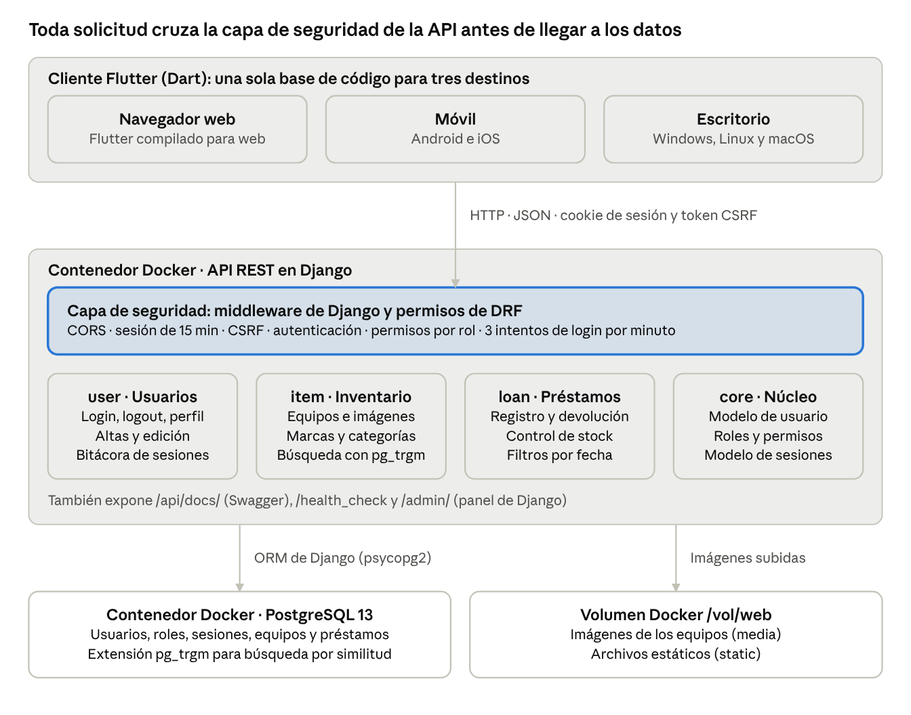

# Proyecto de Ética y Seguridad de Sistemas 2-2026 — LabLend

## 1. Carátula

**Universidad Católica Boliviana "San Pablo"**

Ingeniería de Sistemas

**SIS-325 Ética y Seguridad de Sistemas**

Evaluación 2 basada en proyectos

**Proyecto: Reingeniería de seguridad del sistema LabLend**

Sistema de inventario y préstamo de equipos de laboratorio

**Docente:** Mgr. Ing. Lourdes Peredo Quiroga

**Grupo:** [nombre del grupo]

**Integrantes:** [integrante 1], [integrante 2], [integrante 3]

**Lugar y fecha:** [ciudad], [fecha de entrega]

## 2. Introducción

LabLend es un sistema que digitaliza el inventario y el préstamo de equipos de un laboratorio universitario, y este proyecto aplica sobre él una reingeniería de seguridad. Cuando el préstamo se controla en cuadernos u hojas de cálculo, se pierde la trazabilidad de quién tiene cada equipo, cuántas unidades quedan y cuándo deben volver.

El sistema se desarrolló en 2024 como una API REST en Django con una aplicación Flutter para web y móvil. Se construyó priorizando la funcionalidad, por lo que presenta debilidades de seguridad: credenciales escritas en el código fuente, roles fijos programados en lugar de administrables, una política de contraseñas incompleta y cookies de sesión sin protecciones suficientes.

Este documento describe el sistema en las secciones 3 a 7. Las secciones 8 a 10 documentan la reingeniería de seguridad realizada en el marco de SIS-325: las deficiencias encontradas y su corrección; la gestión de usuarios, roles y contraseñas; y la aplicación de los principios de diseño seguro y las reglas de oro de OWASP. Cada punto se acompaña de capturas del sistema en funcionamiento. Los enlaces al código fuente y al sistema publicado están en la sección Enlaces.

## 3. Nombre y descripción del sistema

**Nombre:** LabLend (de *Lab*, laboratorio, y *Lend*, prestar).

LabLend es un sistema web y móvil para administrar el inventario de equipos de un laboratorio y registrar sus préstamos y devoluciones. Está orientado al Laboratorio de Física de la UCB, cuyo correo institucional aparece en la configuración del sistema.

Tiene dos partes: una API REST en Django que guarda los datos en PostgreSQL, y una aplicación Flutter que se compila para navegador web, Android, iOS y escritorio. Ambas se comunican por HTTP con mensajes JSON, una cookie de sesión y un token CSRF.

**Usuarios del sistema**

| Rol | Quién es | Qué puede hacer |
| --- | --- | --- |
| Visitante (sin sesión) | Estudiante, docente o cualquier persona | Consultar el catálogo de equipos y buscar por nombre, marca y categoría |
| Asistente de laboratorio | Auxiliar que atiende el laboratorio | Iniciar sesión, registrar préstamos, ver y cerrar sus propios préstamos, editar su perfil |
| Administrador de laboratorio | Encargado del laboratorio | Lo anterior, más gestionar equipos, marcas y categorías, y ver todos los préstamos |
| Administrador de seguridad | Responsable de las cuentas; la cuenta inicial se crea al instalar el sistema | Crear, modificar y desactivar cuentas, y consultar la bitácora de sesiones. No gestiona el inventario ni los préstamos (D18) |
| Superadministrador | Cuenta técnica que se puede crear desde el servidor | Pasa todas las comprobaciones de permisos; se elimina en D27 |

**Funcionamiento general**

1. El visitante abre la aplicación y consulta el catálogo sin iniciar sesión.
2. El personal inicia sesión con su código de usuario (por ejemplo, `usr.jperez`) y su contraseña; el servidor abre una sesión de 15 minutos y registra la hora de ingreso.
3. Para prestar, el usuario agrega equipos y cantidades a un carrito y define las fechas de préstamo y devolución.
4. El servidor verifica que haya unidades disponibles (cantidad total menos cantidad prestada) y, si las hay, registra el préstamo y aumenta la cantidad prestada.
5. Al marcar el préstamo como devuelto, las unidades vuelven a quedar disponibles.
6. Al cerrar sesión se registra la hora de salida, que el administrador puede consultar.

## 4. Objetivo del sistema

**Objetivo general:** controlar el inventario y los préstamos de equipos del laboratorio en un sistema centralizado, de modo que en todo momento se sepa qué equipos existen, cuántas unidades están prestadas, a quién y hasta qué fecha.

**Objetivos específicos:**

1. Mantener un catálogo de equipos con marca, categorías, número de serie, imagen, enlace a ficha técnica y cantidad disponible.
2. Registrar cada préstamo con responsable, fecha de préstamo, fecha de devolución y cantidades, validando la disponibilidad antes de aceptarlo.
3. Actualizar automáticamente las unidades prestadas al registrar un préstamo y al marcarlo como devuelto.
4. Restringir las operaciones según el rol del usuario y permitir la consulta pública del catálogo.
5. Registrar el inicio y cierre de sesión de cada usuario para fines de auditoría.
6. Ofrecer la misma funcionalidad en navegador web y en dispositivos móviles.

## 5. Tecnología utilizada

LabLend usa una arquitectura cliente-servidor de tres capas: un cliente Flutter, una API REST en Django y una base de datos PostgreSQL, con el servidor y la base de datos en contenedores Docker.

La aplicación Flutter nunca accede directamente a la base de datos: cada operación pasa por la API, que aplica CORS, sesión, CSRF y permisos por rol antes de tocar los datos. Solo la consulta del catálogo es pública.

| Capa | Tecnología | Uso en LabLend |
| --- | --- | --- |
| Servidor | Python 3.12 | Lenguaje del servidor |
| Servidor | Django 5.2 LTS | Framework web: ORM, autenticación, sesiones, protección CSRF y panel de administración |
| Servidor | Django REST Framework 3.18 | API REST, clases de permiso por rol y limitación de solicitudes (throttling) |
| Servidor | django-filter 26.2 | Filtros de búsqueda de equipos, préstamos y usuarios |
| Servidor | django-password-validators 1.7 | Reglas de complejidad e historial de contraseñas |
| Servidor | django-cors-headers 4.9 | Control de orígenes cruzados (CORS) para el cliente web |
| Servidor | drf-spectacular 0.30 | Documentación OpenAPI y Swagger en /api/docs/ |
| Servidor | Pillow 12.3 | Validación y manejo de las imágenes de los equipos |
| Base de datos | PostgreSQL 17 (psycopg2 2.9) | Almacenamiento; búsqueda por similitud de texto con la extensión pg_trgm |
| Cliente | Flutter con Dart 3.3 o superior | Una sola base de código para web, Android, iOS, Windows, Linux y macOS |
| Cliente | dio 5.1, cookie_jar 4.0, dio_cookie_manager 3.1 | Cliente HTTP y manejo de la cookie de sesión y el token CSRF |
| Cliente | flutter_secure_storage 5.0 | Almacenamiento cifrado del token CSRF en móviles |
| Cliente | provider 6.1 | Manejo del estado de la aplicación |
| Cliente | file_picker 5.0 | Selección de imágenes al registrar equipos |
| Infraestructura | Docker y Docker Compose | Contenedor de la API (Alpine Linux) y contenedor de PostgreSQL |
| Herramientas | Git y GitHub | Control de versiones del código |
| Herramientas | flake8 7 | Análisis estático de estilo del código Python |

## 6. Problemas o necesidades que el sistema resuelve

LabLend reemplaza el control manual del préstamo de equipos, que no permite saber con certeza qué está disponible, quién tiene cada equipo ni quién hizo cada registro.

| Problema o necesidad | Cómo lo resuelve LabLend |
| --- | --- |
| Los préstamos se anotan en cuadernos u hojas sueltas, fáciles de perder o alterar | Cada préstamo queda en la base de datos con responsable, fechas, equipos y cantidades |
| No se sabe cuántas unidades de un equipo quedan disponibles | El sistema lleva la cantidad total y la prestada de cada equipo, y rechaza un préstamo que excede lo disponible |
| Hay equipos que no se devuelven a tiempo | La fecha de devolución es obligatoria y posterior a la de préstamo; se pueden filtrar los préstamos no devueltos por rango de fechas |
| Estudiantes y docentes deben ir al laboratorio para preguntar qué equipos existen | Catálogo público con búsqueda por nombre, marca y categoría, con imagen y enlace a la ficha técnica |
| Cualquiera con acceso al cuaderno puede registrar o modificar un préstamo | Cuentas personales con contraseña y permisos según el rol |
| No queda constancia de quién operó el sistema ni cuándo | Bitácora con la hora de inicio y cierre de sesión de cada usuario |
| El personal atiende desde distintos dispositivos | La misma aplicación funciona en navegador, móvil y escritorio |

## 7. Funcionalidad del sistema (módulos y funciones)

Al terminar la reingeniería, LabLend tendrá 9 módulos: 7 que ya existen y 2 nuevos, gestión de roles y gestión de contraseñas. Las funciones y los roles describen el sistema terminado; la columna Estado indica el avance al 13 de octubre de 2026.

| Módulo | Funciones | Roles con acceso | Ruta en la API | Estado |
| --- | --- | --- | --- | --- |
| 1. Autenticación y sesión | Inicio de sesión con código de usuario (User ID) y contraseña; cierre de sesión; expiración de la sesión a los 15 minutos; mensaje de error genérico que no revela si el usuario existe | Todos los usuarios registrados | /user/token/, /user/logout/ | Implementado |
| 2. Perfil de usuario | Ver y editar el nombre y el correo propios; cambiar la contraseña propia pidiendo la actual y validando la política | Todos los usuarios registrados | /user/me/ | Parcial: el cambio de contraseña no pide la actual ni valida la política |
| 3. Gestión de usuarios (ABM) | Listar usuarios con filtros por rol, estado y correo; crear, modificar y desactivar usuarios; código de usuario (User ID) con formato estándar | Administrador de seguridad | /user/list/, /user/create/, /user/create/admin/, /user/manage/ | Parcial: falta proteger las cuentas de administrador de seguridad entre sí (D27) |
| 4. Gestión de roles | Crear, modificar y eliminar roles; asignar permisos por función; asignar y quitar roles a usuarios; matriz de accesos | Administrador de seguridad | Por definir | Pendiente: hoy hay dos roles fijos en el código |
| 5. Gestión de contraseñas | Política de complejidad y longitud; vencimiento; historial de contraseñas; bloqueo al tercer intento fallido; desbloqueo y reinicio por el administrador; contraseñas iniciales generadas y guardadas en un gestor de contraseñas | Administrador de seguridad | Por definir | Parcial: solo existe la regla de complejidad y longitud; hay un límite de 3 intentos por minuto, pero no bloqueo |
| 6. Bitácora de sesiones | Consultar las horas de inicio y cierre de sesión de un usuario | Administrador de seguridad | /user/log/ | Implementado |
| 7. Inventario | Alta, edición y baja de equipos (nombre, descripción, enlace, número de serie, cantidad, imagen); gestión de marcas y categorías; búsqueda por similitud de nombre y filtros por marca y categoría | Administrador de laboratorio para editar; todos, incluso visitantes, para consultar | /item/items/, /item/brands/, /item/categories/, /item/list/ | Implementado |
| 8. Préstamos | Carrito de equipos; registro del préstamo con fechas y cantidades; validación de disponibilidad; marcar como devuelto; búsqueda por rango de fechas, estado y correo. El asistente ve solo sus préstamos y el administrador ve todos | Administrador de laboratorio, asistente | /loan/loan/ | Implementado |
| 9. Soporte técnico | Documentación interactiva Swagger y verificación del estado del servidor | Desarrolladores | /api/docs/, /health_check | Implementado; el panel /admin/ de Django se eliminó (D9) |

## 8. Alcance de la reingeniería del sistema

La revisión del código del servidor (backend/app) y de la aplicación (frontend/lib) encontró 31 deficiencias de seguridad, y la reingeniería planifica corregirlas todas. Cada fila indica la deficiencia, su corrección, la sección donde se demuestra y su categoría en el [OWASP Top 10:2025](https://top10.owasp.org/2025); la columna Estado indica el avance al 16 de octubre de 2026.

Categorías OWASP usadas: A01 Control de acceso roto, A02 Configuración de seguridad incorrecta, A03 Fallas en la cadena de suministro de software, A04 Fallas criptográficas, A06 Diseño inseguro, A07 Fallas de autenticación, A09 Fallas en el registro y las alertas de seguridad, A10 Manejo incorrecto de condiciones excepcionales. La revisión no encontró casos de A05 Inyección ni de A08 Fallas de integridad del software o de los datos: el código no usa SQL directo, y todas las consultas pasan por el ORM de Django, que trata los datos del usuario como parámetros. La descripción de cada categoría, en español y en inglés, y las deficiencias que le corresponden están en [owasp-top10.md](owasp-top10.md).

### 8.1 Configuración, secretos y despliegue

| N.º | Deficiencia encontrada | Corrección | Se demuestra en | OWASP | Estado |
| --- | --- | --- | --- | --- | --- |
| D1 | La clave secreta de Django (SECRET_KEY) está escrita en settings.py y publicada en GitHub | Leerla de la variable de entorno DJANGO_SECRET_KEY, sin valor por defecto (el servidor no arranca sin ella), y generar una nueva por instalación | 10 (seguridad por defecto) | A04 | Implementado |
| D2 | La contraseña del correo Gmail está en settings.py, y docker-compose.yml usa las credenciales de base de datos de ejemplo (changeme) | Credenciales de base de datos en variables de entorno (archivo .env fuera del repositorio); eliminar la configuración de Gmail, que el sistema no usa; cambiar las contraseñas expuestas, que siguen en el historial de git | 10 (seguridad por defecto, minimizar la superficie de ataque) | A02 | Implementado |
| D3 | Cada migración crea un superusuario con correo y contraseña fijos, escritos en core/models.py y core/signals.py | Eliminar la creación automática; la cuenta inicial es un administrador de seguridad creado con un comando (create_initial_admin), con una contraseña generada y guardada en el gestor de contraseñas | 9.3 y 10 (mecanismo menos común) | A07 | Implementado |
| D4 | La aplicación Flutter inicia sesión como superadministrador al arrancar, con esa contraseña escrita en frontend/lib/main.dart, así que todos los usuarios comparten la misma cuenta | Eliminar el inicio automático: cada persona entra por la pantalla de login con su propia cuenta; las vistas previas de desarrollo reciben la cuenta con --dart-define | 10 (mecanismo menos común) | A07 | Implementado |
| D5 | DEBUG=True: ante un error, el servidor muestra el código, la configuración y las rutas | DEBUG desactivado por defecto (solo se activa con DJANGO_DEBUG en desarrollo) y ALLOWED_HOSTS limitado al dominio del hosting (DJANGO_ALLOWED_HOSTS); sin DEBUG, el servidor no arranca si faltan los dominios permitidos o los orígenes de CORS | 10 (fallar de forma segura, seguridad por defecto) | A02 | Implementado |
| D6 | CORS acepta peticiones con credenciales desde cualquier origen | Aceptar solo el dominio del sistema, configurado en la variable de entorno CORS_ALLOWED_ORIGINS | 10 (minimizar la superficie de ataque) | A01 | Implementado |
| D7 | La cookie de sesión se puede leer desde JavaScript (SESSION_COOKIE_HTTPONLY=False) | Cookie HttpOnly y SameSite=Lax, sirviendo la aplicación y la API desde el mismo dominio | 10 (defensa en profundidad) | A02 | Pendiente |
| D8 | El sistema funciona por HTTP con el servidor de desarrollo de Django (runserver) | HTTPS del hosting con HSTS y redirección, y un servidor de producción (Gunicorn) | 10 (seguridad por defecto) | A04 | Pendiente |
| D9 | El panel de administración de Django está activo en /admin/ y permite gestionar usuarios fuera de la aplicación | Eliminar el panel en todos los entornos, no solo en producción: se quitan la ruta /admin/ y la aplicación django.contrib.admin, así que /admin/ responde 404. Usuarios y roles se gestionan solo desde la aplicación, donde pasan por los permisos y el registro de sesiones | 10 (minimizar la superficie de ataque) | A02 | Implementado |
| D10 | Django 3.2 y Pillow 8.2 ya no reciben parches de seguridad (Django 3.2 perdió soporte en abril de 2024) | Actualizar a Django 5.2 LTS con Python 3.12 y PostgreSQL 17, y a versiones con soporte de las demás librerías | 10 (seguridad por defecto) | A03 | Implementado |

### 8.2 Usuarios y autenticación

| N.º | Deficiencia encontrada | Corrección | Se demuestra en | OWASP | Estado |
| --- | --- | --- | --- | --- | --- |
| D11 | No existe un código de usuario: se inicia sesión con el correo | Código de usuario (User ID) con formato estándar, generado al crear la cuenta y usado para iniciar sesión: prefijo + inicial del primer nombre + apellido paterno, en minúsculas y sin tildes ni ñ. El administrador de seguridad usa `adm.` (`adm.jperez`) y los demás usuarios `usr.` (`usr.mquispe`); si el código ya existe se agrega un número (`usr.mquispe2`). El nombre se guarda en tres campos (nombres, apellido paterno y apellido materno) para no confundir apellidos compuestos (`usr.jdelacruz`). El código no se puede elegir ni cambiar, y el correo deja de servir para iniciar sesión | 9.1 | — (requisito del curso) | Implementado |
| D12 | El login responde distinto si el correo no existe (404) o si la contraseña es incorrecta (401), lo que permite averiguar qué correos están registrados | Un solo mensaje genérico para ambos casos: el login responde 401 con "Código de usuario o contraseña incorrectos" si el código no existe, si la contraseña es incorrecta o si la cuenta está desactivada. El servidor verifica la contraseña también para códigos inexistentes, así el tiempo de respuesta no los delata, y el límite de 3 intentos por minuto se aplica a cualquier código, exista o no | 10 (fallar de forma segura) | A07 | Implementado |
| D13 | Un administrador de laboratorio puede editar cualquier cuenta, incluida la del superadministrador, y cambiarle la contraseña (/user/manage/) | Solo el administrador de seguridad gestiona cuentas (resuelto con D18): el administrador de laboratorio recibe 403 en /user/manage/ y en los demás endpoints de cuentas. Como hay un único nivel de administración de cuentas, no existen cuentas con más privilegios que el administrador de seguridad; la protección de las cuentas de administrador de seguridad entre sí y la eliminación del superusuario quedan en D27 | 9.1 y 10 (mínimo privilegio) | A01 | Implementado |
| D14 | Un usuario puede cambiar su correo y su contraseña sin confirmar la contraseña actual (/user/me/) | Pedir la contraseña actual para cambiar la contraseña o el correo; el administrador de seguridad ya no escribe contraseñas ajenas: para una cuenta ajena genera un enlace de restablecimiento (D24) | 9.3 | A07 | Pendiente |
| D30 | La API acepta credenciales HTTP Basic en cualquier endpoint (configuración por defecto de Django REST Framework), y esa verificación ocurre antes del límite de intentos, así que se pueden probar contraseñas sin pasar por el login ni su límite de 3 intentos por minuto | Aceptar solo la autenticación por sesión que se obtiene en /user/token/ | 10 (economía del mecanismo, mediación completa) | A07 | Implementado |
| D31 | La pantalla de login muestra un botón con el logo de inicio de sesión de Google que no autentica: solo abre accounts.google.com en otra pestaña, lo que hace creer que existe un segundo método de ingreso y acostumbra a los usuarios a escribir sus credenciales en una página a la que los envía la aplicación | Quitar el botón: el único método de ingreso es el código de usuario y la contraseña | 10 (menos asombro, minimizar la superficie de ataque) | A06 | Implementado |

### 8.3 Roles y permisos

| N.º | Deficiencia encontrada | Corrección | Se demuestra en | OWASP | Estado |
| --- | --- | --- | --- | --- | --- |
| D15 | Solo hay dos roles fijos en el código (core/models.py), y no se pueden crear, editar ni eliminar roles | Control de acceso basado en roles (RBAC): roles guardados en la base de datos, con permisos por función, administrados desde la aplicación; un usuario puede tener uno o varios roles | 9.2 | A01 | Pendiente |
| D16 | Cada vista compara el nombre del rol por su cuenta (IsLabAdmin), y los permisos declarados en el modelo LabAdmin no se usan | Un único mecanismo que verifica, en cada petición, el permiso de la función solicitada | 9.2 y 10 (economía del mecanismo, mediación completa) | A01 | Pendiente |
| D17 | La aplicación Flutter arma su menú con nombres de rol fijos (frontend/lib/models/User.dart) y muestra opciones que el servidor luego rechaza, como marcas y categorías al asistente | Menú construido a partir de los permisos que devuelve el servidor | 9.2 y 10 (menos asombro) | A01 | Pendiente |
| D18 | El mismo administrador gestiona el inventario y las cuentas de usuario | Rol de administrador de seguridad, separado del administrador de laboratorio, y una regla que impide asignar ambos roles al mismo usuario. El administrador de seguridad gestiona las cuentas y consulta la bitácora de sesiones, pero no el inventario ni los préstamos; el administrador de laboratorio gestiona el inventario y ve todos los préstamos, pero ya no las cuentas. El rol de administrador de seguridad no se puede asignar ni quitar a una cuenta existente (la API responde 400): hoy solo lo tiene la cuenta inicial (create_initial_admin), con el prefijo `adm.`, y crear otros administradores de seguridad desde la aplicación queda para la gestión de roles (D15). Así nadie tiene a la vez ese rol y uno del laboratorio. Cuando un usuario pueda tener varios roles (D15), esta regla se mantiene | 9.2 y 10 (segregación de roles) | A01 | Implementado |
| D19 | No existe una matriz de accesos documentada | Matriz de accesos por rol y función, verificable en la aplicación | 9.2 | A01 | Pendiente |
| D27 | El superusuario de Django pasa todas las comprobaciones de permisos, y el código le agrega excepciones explícitas (isAdmin e IsLogged en core/models.py) | Eliminar el superusuario: ninguna cuenta queda fuera de RBAC. El rol de administrador de seguridad queda protegido: no se puede eliminar; un administrador de seguridad no puede modificar ni desactivar la cuenta de otro administrador de seguridad (cada uno cambia solo sus propios datos, desde su perfil), y no se puede desactivar al último administrador de seguridad activo, para que el sistema nunca quede sin quien gestione las cuentas | 9.2 y 10 (mínimo privilegio, mediación completa) | A01 | Pendiente |

### 8.4 Contraseñas

| N.º | Deficiencia encontrada | Corrección | Se demuestra en | OWASP | Estado |
| --- | --- | --- | --- | --- | --- |
| D20 | Al cambiar una contraseña no se valida la política (UserSerializer.update en user/serializers.py) | Validar la política en toda creación y cambio de contraseña, respondiendo 400 con los requisitos que no se cumplen | 9.3 | A07 | Implementado |
| D21 | Las contraseñas no vencen | Vencimiento a los 90 días. El usuario la renueva por su cuenta, sin intervención del administrador: inicia sesión con la contraseña vencida y el sistema le exige cambiarla antes de cualquier otra acción, ingresando la actual y una nueva. Mientras no la cambie, el servidor solo acepta el cambio de contraseña y el cierre de sesión, así que una aplicación modificada no puede saltarse el paso. Los 90 días se cuentan desde que el usuario eligió su contraseña, también cuando la definió con un enlace (D24, D26) | 9.3 | A07 | Pendiente |
| D22 | El historial de contraseñas está instalado pero no configurado, así que se puede reutilizar una contraseña anterior | Impedir reutilizar las últimas 5 contraseñas, en todo cambio: el propio (D14), por vencimiento (D21) y con un enlace (D24, D26) | 9.3 | A07 | Pendiente |
| D23 | No hay bloqueo de cuenta, solo un límite de 3 intentos por minuto que se reinicia solo | Bloquear la cuenta al tercer intento fallido; se desbloquea con un enlace de restablecimiento generado por el administrador de seguridad (D24) | 9.3 | A07 | Pendiente |
| D24 | No se puede desbloquear una cuenta ni reiniciar una contraseña, y el botón "Recuperar contraseña" no hace nada | Si el usuario olvidó su contraseña o su cuenta está bloqueada, lo solicita al administrador de seguridad, que genera un enlace de restablecimiento de un solo uso con vencimiento de 24 horas. Al generarlo, la contraseña anterior deja de funcionar y se cierran las sesiones abiertas de la cuenta, por si estaba comprometida. El usuario abre el enlace, ve su código de usuario y elige una nueva contraseña que cumpla la política; el enlace deja de funcionar al usarse. Ninguna contraseña viaja por correo ni por otro medio, y el administrador nunca la conoce. El botón "Recuperar contraseña" indica que se debe pedir el enlace al administrador de seguridad | 9.3 y 10 (menos asombro) | A07 | Pendiente |
| D25 | El algoritmo de hash de contraseñas no está definido ni documentado (se usa PBKDF2-SHA256 por omisión) | Definir y documentar el algoritmo (Argon2 o PBKDF2-SHA256) | 9.3 | A04 | Pendiente |
| D26 | No hay un procedimiento para generar ni resguardar las contraseñas de los usuarios: el administrador las escribe a mano | Las cuentas nuevas no reciben una contraseña: al crearlas, el sistema genera automáticamente un enlace de activación de un solo uso con vencimiento de 24 horas y lo muestra una sola vez al administrador de seguridad, que lo entrega a la persona. Al abrirlo, la persona ve su código de usuario y elige su contraseña. Si el enlace vence, el administrador genera otro. No se envían contraseñas por correo: quedarían legibles en la bandeja de entrada y obligarían a guardar credenciales de un servidor de correo (ver D2). La excepción es la cuenta inicial, que se crea antes de que exista la aplicación: create_initial_admin genera su contraseña al azar y la muestra una sola vez, para guardarla en un gestor de contraseñas (por ejemplo Bitwarden o KeePassXC) | 9.3 | A06 | Pendiente |

### 8.5 Registro de eventos y manejo de errores

| N.º | Deficiencia encontrada | Corrección | Se demuestra en | OWASP | Estado |
| --- | --- | --- | --- | --- | --- |
| D28 | Solo se registran el inicio y el cierre de sesión: los intentos fallidos, los bloqueos, los desbloqueos y los cambios de roles y permisos no dejan rastro | Registrar estos eventos de seguridad con fecha, usuario y acción, consultables por el administrador de seguridad | 9.2 y 9.3 | A09 | Pendiente |
| D29 | Si una validación del modelo falla, por ejemplo un préstamo con la fecha de devolución anterior a la de préstamo, la API responde con error 500 en lugar de 400 y, con DEBUG activo, muestra la traza completa | Convertir los errores de validación en respuestas 400 con un mensaje claro, revertir el préstamo completo si falla, y registrar los errores inesperados sin mostrar detalles internos | 10 (fallar de forma segura) | A10 | Implementado |

## Enlaces

**Código fuente (GitHub):** https://github.com/Andrewing1000/LabLend

**Política de contraseñas:** [politica-contrasenas.md](politica-contrasenas.md)

**Sistema publicado (hosting):** [URL del sistema]

**Usuario administrador de seguridad:** [usuario]

**Contraseña del administrador de seguridad:** [contraseña]
